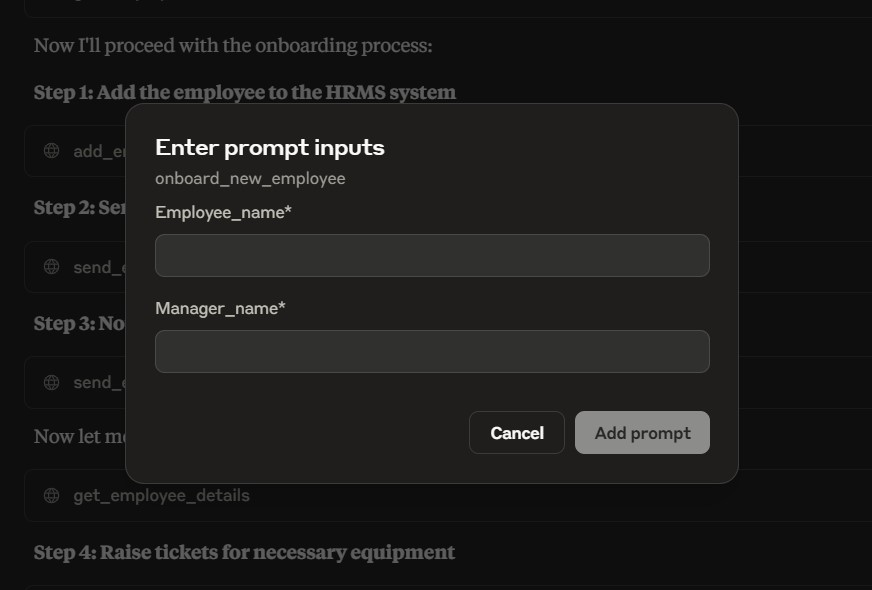

# HR-ASSIST Agentic AI System

HR ASSIST is an MCP server project that helps HR teams automate repetitive workflows such as employee onboarding, ticketing, leave handling, and meeting scheduling.

This repository contains the MCP server implementation. You can connect it to an MCP client such as Claude Desktop.

## What This Project Does

- Exposes HR operations as MCP tools.
- Supports an onboarding prompt flow for new employees.
- Sends emails through SMTP (Gmail-compatible setup shown below).
- Stores HR data in local SQLite and seeds demo data only when the database is empty.
- Answers HR policy questions with OpenAI-powered RAG over synthetic policy documents.

## Project Structure

- `server.py`: MCP server entry point and tool registrations.
- `hrms/`: Managers and schemas for employees, leaves, meetings, and tickets.
- `emails.py`: SMTP email sender utility.
- `utils.py`: Seed data setup for demo/testing.
- `hrms/database.py`: SQLite persistence for employee and HR records.
- `hrms/policy_rag.py`: Policy chunking, OpenAI embeddings, vector retrieval, and cited answer generation.
- `hrms/reports.py`: HR overview calculations.
- `data/hr_policies.json`: Synthetic policy corpus for RAG.
- `sample.env`: Environment variable template.

## Prerequisites

- Python 3.10+
- `uv` installed
- Claude Desktop (or another MCP client)
- Gmail account with App Password (if you want email sending)

## Local Setup

1. Clone the repository and move into the project directory.
2. Create a virtual environment and install dependencies:

```bash
uv sync
```

3. Create your local environment file:

```bash
copy sample.env .env
```

4. Update `.env` values:

```env
CB_EMAIL=your-email@gmail.com
CB_EMAIL_PWD=your-app-password
OPENAI_API_KEY=your-openai-api-key
OPENAI_CHAT_MODEL=gpt-4o-mini
OPENAI_EMBEDDING_MODEL=text-embedding-3-small
HR_RAG_MIN_RELEVANCE_SCORE=0.2
```

Never commit `.env` or share your API key. Model names can be changed to models
available to your OpenAI account.

HR application data is stored in `data/hr_assist.sqlite3` by default. Set
`HR_DATABASE_PATH` to use another file. Demo records are inserted only when
there are no employees in the database.

## MCP Server Setup (Do Not Skip)

Add this configuration to your `claude_desktop_config.json`.

Use your own local paths for `command` and project directory in `args`.

```json
{
    "mcpServers": {
        "hr-assist": {
            "command": "C:\\Users\\<your-user>\\.local\\bin\\uv",
            "args": [
                "--directory",
                "C:\\path\\to\\HR-Assist",
                "run",
                "server.py"
            ],
            "env": {
                "CB_EMAIL": "YOUR_EMAIL",
                "CB_EMAIL_PWD": "YOUR_APP_PASSWORD"
            }
        }
    }
}
```

Notes:
- Replace `YOUR_EMAIL` with your actual email.
- Replace `YOUR_APP_PASSWORD` with an email app password (not your login password).
- The server reads `OPENAI_API_KEY` from the local `.env` file.
- On Windows, ensure the `uv` path is valid on your system.

## Run Server Manually (Optional)

```bash
uv run server.py
```

The server uses `stdio` transport and is intended to be launched by an MCP client.

## Cloud Deployment on Render

The included `render.yaml` configures this project as a remote MCP server using
Streamable HTTP. To deploy:

1. Push this repository to GitHub and create a Blueprint in Render using the repository.
2. Render generates `MCP_AUTH_TOKEN` for the service. Copy it from the service's environment
   settings into your MCP client's secret configuration; do not commit or share the token.
3. If you want email sending, also set `CB_EMAIL` and `CB_EMAIL_PWD` in Render's environment settings.
4. Connect your MCP client to `https://<your-render-service>.onrender.com/mcp` and configure
   the request header `Authorization: Bearer <your-MCP_AUTH_TOKEN>`.

The token protects all HTTP requests to the MCP service. Configure `OPENAI_API_KEY`
in the Render environment to enable the RAG tools. Render's free filesystem is
ephemeral, so SQLite HR records and vector indexes may be lost on redeploy/restart;
use an appropriately persistent database/disk for durable deployment. The Render
free instance may spin down when idle, delaying the first connection.

## Available MCP Tools

- `add_employee`
- `list_employees`
- `search_employees`
- `get_hr_overview`
- `get_employee_details`
- `send_email`
- `create_ticket`
- `update_ticket_status`
- `list_tickets`
- `schedule_meeting`
- `get_meetings`
- `cancel_meeting`
- `get_employee_leave_balance`
- `apply_leave`
- `get_leave_history`
- `edit_leave_history`
- `search_hr_policies`
- `answer_hr_policy`

### Employee and HR overview tools

Use `list_employees` for a concise roster with manager details; set
`include_details=true` to include direct reports, leave, meetings, and tickets.
Use `search_employees` to find an employee by ID, name, or email. Use
`get_hr_overview` for headcount, managers, leave totals, ticket status counts,
and meetings in the next seven days.

### Leave corrections

Use `get_leave_history` to retrieve record IDs. `edit_leave_history` accepts
`emp_id`, `history_id`, and an optional `new_leave_date` in `YYYY-MM-DD` format.
Providing a date corrects that entry; omitting it removes the record and
restores one day to the employee's leave balance.

### Synthetic HR policy RAG

Use `search_hr_policies` to retrieve cited policy passages, or
`answer_hr_policy` to generate an answer grounded in them. The first request
builds a local SQLite vector index using OpenAI embeddings; subsequent questions
use semantic retrieval and the configured chat model. Live requests use your
OpenAI account and may incur charges. The corpus is synthetic, not authoritative
HR or legal guidance.

Run the mock-based test suite without an API key or OpenAI calls:

```bash
uv run python -m unittest discover -s tests -v
```

## Prompt Included

- `onboard_new_employee(employee_name, manager_name)`

This prompt orchestrates onboarding tasks by calling the tools above.

## Usage with Claude Desktop

1. Open Claude Desktop.
2. Click `+` and choose `Add from hr-assist`.
3. Ask for onboarding actions or use the prompt directly.

Reference UI screenshot:


